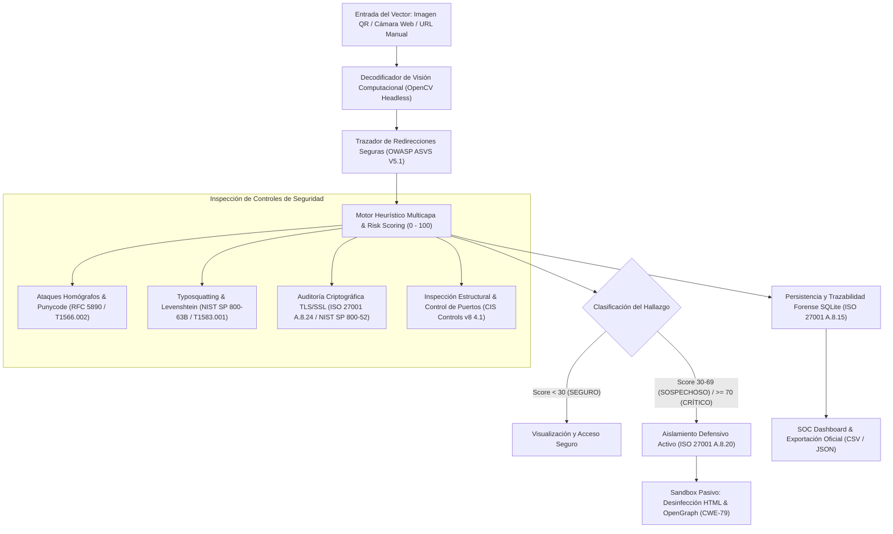

# 🛡️ PhishHunter Live
### Sistema de Inspección Heurística y Aislamiento Preventivo contra Amenazas de Quishing mediante Visión Computacional

[](https://www.python.org/)
[](https://streamlit.io/)
[](https://opencv.org/)
[]()
[]()

---

## 📌 1. Visión General y Arquitectura

**PhishHunter Live** es una plataforma interactiva de ciberdefensa orientada a Centros de Operaciones de Seguridad (SOC), analistas de incidentes y laboratorios forenses. Su objetivo es detectar, mitigar y contener de forma preventiva amenazas de **Quishing** (Phishing vehiculizado mediante códigos QR).

La solución combina algoritmos de **visión computacional headless (OpenCV)** para la lectura y delimitación de simbologías QR, junto a un **motor analítico de inspección defensiva** que evalúa vectores de ataque en tiempo real y ejecuta un **sandbox pasivo** que neutraliza enlaces maliciosos y desarma el código ejecutable del cliente (JavaScript/XSS), garantizando una contención segura antes de que un usuario o analista caiga en el engaño.



---

## 🏛️ 2. Mapeo Exhaustivo de Controles de Seguridad y Estándares

PhishHunter Live fue diseñado bajo estrictos criterios de auditoría y controles de seguridad de la información:

| Estándar / Marco | Control / Requisito | Mecanismo de Mitigación en PhishHunter Live |
| :--- | :--- | :--- |
| **ISO/IEC 27001:2022** | **A.8.15** (Registro de Auditoría y Trazabilidad) | Persistencia local en SQLite (`phishhunter.db`), registrando ID, timestamp UTC, payload original, URL final, saltos, score, desglose en JSON e IP cliente. |
| **ISO/IEC 27001:2022** | **A.8.20** (Seguridad en Redes y Aislamiento) | Bloqueo preventivo incondicional de hipervínculos cuando el Risk Score es $\ge 30$, forzando inspección a través del Sandbox Pasivo. |
| **ISO/IEC 27001:2022** | **A.8.24** (Uso de Criptografía) | Verificación de obligatoriedad de HTTPS, auditoría de certificados SSL/TLS y detección de degradación criptográfica (*SSL Strip*). |
| **OWASP ASVS v4.0** | **V5.1 / CWE-601** (Open Redirects) | Rastreo controlado salto a salto (301, 302, 307, 308) con timeout estricto de 4.0s, User-Agent neutro y detección de pivoteo entre dominios no relacionados. |
| **OWASP Top 10** | **CWE-79** (Cross-Site Scripting) | Purgado total de etiquetas `<script>`, `<iframe>`, `<object>`, atributos interactivos (`onclick`, etc.) y desactivación de formularios en el Sandbox. |
| **NIST SP 800-63B** | Mitigación de Impersonación | Algoritmo de distancia de edición de Levenshtein contra catálogo oficial de marcas bancarias, fintech, corporativas y logísticas. |
| **NIST SP 800-52 Rev. 2** | Transporte TLS y Puertos | Detección de puertos anómalos (ej. `:8080`, `:4444`, `:1337`, `:9000`) y auditoría de suites TLS en destino. |
| **CIS Controls v8** | **Control 4.1** (Configuraciones Seguras) | Alerta crítica por uso directo de direcciones IP numéricas en URLs y penalización de TLDs de alto riesgo estadístico (`.xyz`, `.top`, `.live`, etc.). |
| **RFC 5890 / MITRE** | **T1566.002 / T1583.001** | Detección de ataques homógrafos IDN con prefijo Punycode (`xn--`) y análisis de caracteres confusables no latinos (cirílico/griego). |

---

## 🗂️ 3. Estructura Modular del Proyecto

```
phishhunter-live/
├── .env.example               # Variables de entorno modelo (puertos, timeouts, db)
├── .gitignore                 # Exclusiones de Git (entornos virtuales, SQLite, logs)
├── Dockerfile                 # Imagen liviana basada en python:3.11-slim
├── render.yaml                # Infraestructura como código (IaC) para Render
├── requirements.txt           # Dependencias fijadas (opencv-python-headless, etc.)
├── README.md                  # Documentación de arquitectura y guías operativas
├── app.py                     # Interfaz web interactiva SOC en Streamlit
├── database/
│   ├── __init__.py
│   └── db_manager.py          # Gestor SQLite thread-safe y exportación CSV/JSON
├── core/
│   ├── __init__.py
│   ├── qr_decoder.py          # Extracción y decodificación de QR con OpenCV
│   ├── url_tracer.py          # Trazador de redirecciones HTTP y auditoría TLS
│   ├── heuristic_engine.py    # Motor de cálculo de Risk Score (0-100) y controles
│   └── sandbox_preview.py     # Sandbox pasivo con desinfección HTML y OpenGraph
├── utils/
│   ├── __init__.py
│   └── threat_signatures.py   # Catálogo de marcas protegidas, homógrafos y TLDs
└── tests/
    ├── __init__.py
    └── test_heuristics.py     # Suite de 13 pruebas unitarias automatizadas con pytest
```

---

## 🚀 4. Guía de Ejecución Local

### Prerrequisitos
- **Python 3.11** instalado en su sistema.
- Gestor de paquetes `pip` y soporte para entornos virtuales `venv`.

### Paso 1: Clonar o posicionarse en el repositorio
```bash
cd phishhunter-live
```

### Paso 2: Crear y activar un entorno virtual aislado
En **Linux / macOS**:
```bash
python3.11 -m venv .venv
source .venv/bin/activate
```

En **Windows (PowerShell)**:
```powershell
python -m venv .venv
.\.venv\Scripts\Activate.ps1
```

### Paso 3: Instalar dependencias del proyecto
```bash
pip install --upgrade pip
pip install -r requirements.txt
```

### Paso 4: Configurar variables de entorno (Opcional)
```bash
cp .env.example .env
```

### Paso 5: Lanzar la aplicación interactiva Streamlit
```bash
streamlit run app.py
```
> La interfaz se iniciará automáticamente en su navegador web en `http://localhost:8501`.

---

## 🧪 5. Ejecución de Pruebas Unitarias Automatizadas

El proyecto incluye una suite de pruebas con `pytest` que valida matemáticamente y de forma determinista todos los controles heurísticos, la persistencia en SQLite, la desinfección del Sandbox y el decodificador de visión computacional.

Para ejecutar todas las pruebas:
```bash
python -m pytest -v
```

Salida esperada:
```text
tests/test_heuristics.py::test_levenshtein_distance_algorithm PASSED     [  7%]
tests/test_heuristics.py::test_base_domain_extraction PASSED             [ 15%]
tests/test_heuristics.py::test_homograph_punycode_detection PASSED       [ 23%]
tests/test_heuristics.py::test_homograph_cyrillic_lookalike PASSED       [ 30%]
tests/test_heuristics.py::test_typosquatting_detection PASSED            [ 38%]
tests/test_heuristics.py::test_combosquatting_brand_embedding PASSED     [ 46%]
tests/test_heuristics.py::test_legitimate_domain_is_safe PASSED          [ 53%]
tests/test_heuristics.py::test_structural_direct_public_ip PASSED        [ 61%]
tests/test_heuristics.py::test_structural_risky_tld_and_keywords PASSED  [ 69%]
tests/test_heuristics.py::test_anomalous_port_detection PASSED           [ 76%]
tests/test_heuristics.py::test_qr_generation_and_decoding PASSED         [ 84%]
tests/test_heuristics.py::test_sandbox_html_sanitization PASSED          [ 92%]
tests/test_heuristics.py::test_database_persistence_and_metrics PASSED   [100%]
============================= 13 passed in 1.11s ==============================
```

---

## 🐳 6. Ejecución en Contenedor Docker

El proyecto incluye un `Dockerfile` optimizado y multi-plataforma que utiliza la imagen liviana `python:3.11-slim`:

### Construcción de la imagen:
```bash
docker build -t phishhunter-live:latest .
```

### Ejecución del contenedor:
```bash
docker run -d -p 8501:8501 --name phishhunter phishhunter-live:latest
```
Acceda a la aplicación en `http://localhost:8501`.

---

## ☁️ 7. Despliegue en Render (Tier Gratuito)

El repositorio incluye el archivo de infraestructura como código `render.yaml`, facilitando el despliegue directo en el tier gratuito de Render:

### Opción A: Despliegue con Blueprints (Recomendado)
1. Suba este repositorio a su cuenta de **GitHub** o **GitLab**.
2. Inicie sesión en [Render.com](https://render.com/).
3. En el panel principal, haga clic en **New +** y seleccione **Blueprint**.
4. Conecte su repositorio. Render detectará automáticamente el archivo `render.yaml`.
5. Haga clic en **Apply**. Render aprovisionará el servicio, instalará las dependencias y enlazará dinámicamente la variable `$PORT`.

### Opción B: Despliegue Manual como Web Service
1. En Render, cree un **New Web Service**.
2. Conecte el repositorio del proyecto.
3. Complete los siguientes parámetros:
   - **Environment:** `Python 3`
   - **Region:** `Oregon (US West)` o la más cercana
   - **Branch:** `main`
   - **Build Command:** `pip install --upgrade pip && pip install -r requirements.txt`
   - **Start Command:** `streamlit run app.py --server.port $PORT --server.address 0.0.0.0 --server.enableCORS false --server.enableXsrfProtection false --browser.gatherUsageStats false`
   - **Instance Type:** `Free`
4. Añada las variables de entorno en la sección **Environment Variables**:
   - `PYTHON_VERSION`: `3.11.9`
   - `DATABASE_PATH`: `database/phishhunter.db`
   - `HTTP_TIMEOUT`: `4.0`
5. Haga clic en **Deploy Web Service**.

---

## 🛡️ 8. Motor de Ponderación de Riesgo (Risk Scoring Engine)

El cálculo del **Risk Score (0 a 100)** es acumulativo y cuantifica el impacto defensivo de cada anomalía detectada:

| Categoría | Rango de Puntuación | Color / Insignia | Acción Defensiva Ejecutada |
| :--- | :---: | :---: | :--- |
| **SEGURO** | $0 \le \text{Score} < 30$ | 🟢 Verde | Conexión confiable sin indicadores de compromiso. Se habilita previsualización estándar. |
| **SOSPECHOSO** | $30 \le \text{Score} < 70$ | 🟡 Amarillo | Anomalías estructurales o de red presentes. Se activa el **Sandbox Pasivo** y se neutralizan enlaces. |
| **CRÍTICO / QUISHING** | $70 \le \text{Score} \le 100$ | 🔴 Rojo | Confirmación de ataque (homógrafo, typosquatting o suplantación deliberada). **Aislamiento preventivo total**. |

---

## ⚖️ Licencia y Propósito Educativo / Forense
Este proyecto se distribuye para fines de investigación en ciberseguridad, análisis forense de incidentes y protección preventiva de infraestructuras corporativas contra campañas de ingeniería social por QR.
